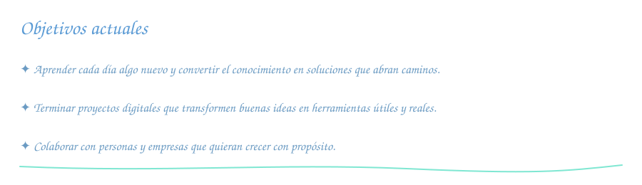

<!--
╔══════════════════════════════════════════════════════════════════╗
║  PLANTILLA DE README DE PERFIL DE GITHUB                         ║
║                                                                  ║
║  CÓMO USARLA                                                     ║
║  1. Crea un repo PÚBLICO con el mismo nombre que tu usuario.     ║
║  2. Pega este contenido en su README.md.                         ║
║  3. Busca y reemplaza (Ctrl+H) estos marcadores:                 ║
║       TU_USUARIO  → tu usuario de GitHub                         ║
║       TU_NOMBRE   → tu nombre                                    ║
║       TU_LINKEDIN → tu usuario de LinkedIn                       ║
║       TU_EMAIL    → tu correo                                    ║
║  4. Edita los textos marcados con ✏️ y borra las secciones        ║
║     marcadas como OPCIONAL que no quieras.                       ║
║  Estos comentarios <!‐‐ ‐‐> no se ven en GitHub; puedes dejarlos.║
╚══════════════════════════════════════════════════════════════════╝
-->

<!-- ═══════════════ 1. CABECERA ═══════════════ -->

<!-- OPCIONAL: tu foto. Súbela a una carpeta Images/ del repo con ese nombre,
     o borra este bloque. -->

  

<!-- Texto animado. Para cambiar frases, fuente o color, genera la URL en:
     https://readme-typing-svg.demolab.com
     Cada frase va separada por ";" y los espacios se escriben como "+". -->

  

<!-- ═══════════════ 2. CONTACTO ═══════════════ -->
<!-- Más insignias en https://shields.io/badges  (cambia el nombre, el color
     hexadecimal y el logo; los logos salen de https://simpleicons.org) -->

  
  &nbsp;&nbsp;&nbsp;
  
  &nbsp;&nbsp;&nbsp;
  <!-- OPCIONAL: portfolio -->
  

  
  <!-- OPCIONAL: contador de visitas -->
  <!--  -->

---

<!-- ═══════════════ 3. SOBRE MÍ ═══════════════ -->
<!-- ### 👨‍💻 Sobre mí -->

<!-- ✏️ Dos o tres líneas sobre ti -->
Hola, soy Jacinto y vivo en Granada, Andalucía (España). Mi trabajo se basa en el compromiso con cada cliente: comprender sus necesidades, asesorarle y encontrar soluciones prácticas para impulsar el crecimiento de su empresa. También me interesa cómo la tecnología puede ayudar a mejorar su presencia y visibilidad.

- 🔭 Actualmente, me enfoco en **identificar oportunidades de mejora y crecimiento para empresas mediante soluciones digitales**.
- 🌱 Sigo ampliando mis conocimientos en **desarrollo web y herramientas tecnológicas aplicadas a las necesidades de negocio**.
- 🤝 Me interesa colaborar con **personas y empresas que quieran fortalecer su presencia digital y avanzar en sus proyectos**.
- 💡 Mi enfoque combina **escucha activa, compromiso y soluciones orientadas a objetivos concretos**.

---

<!-- ═══════════════ 4. TECNOLOGÍAS ═══════════════ -->
### 🧰 Tecnologías y herramientas

<!-- Cambia la lista después de "i=" separando por comas.
     Nombres disponibles: https://skillicons.dev  (ej.: python, react, spring,
     docker, nodejs, ts, php, laravel, postgres, mongodb, figma, linux...) -->

  

---

<!-- ═══════════════ 5. ESTADÍSTICAS ═══════════════ -->
### 📊 Estadísticas de GitHub

<!-- Temas disponibles: dark, radical, tokyonight, react, dracula, gruvbox,
     onedark, github_dark, transparent...
     Cambia "theme=react" en las TRES imágenes para que combinen.
     Nota: la instancia pública de github-readme-stats a veces no carga por
     límites de uso; si te pasa a menudo, se puede desplegar una propia. -->

  
  

  

---

<!-- ═══════════════ 6. PROYECTOS DESTACADOS (OPCIONAL) ═══════════════ -->
### 📌 Proyectos destacados

<!-- Cambia NOMBRE_REPO por repos tuyos. Añade o quita tarjetas. -->

  
  

---

<!-- ═══════════════ 7. OBJETIVOS ═══════════════ -->
<!-- ✏️ -->

  

---

<!-- ═══════════════ 8. CIERRE ═══════════════ -->
<!-- ✏️ Una frase que te guste, o borra la línea -->
<!-- > "Escribe aquí tu frase." – Autor -->

  

